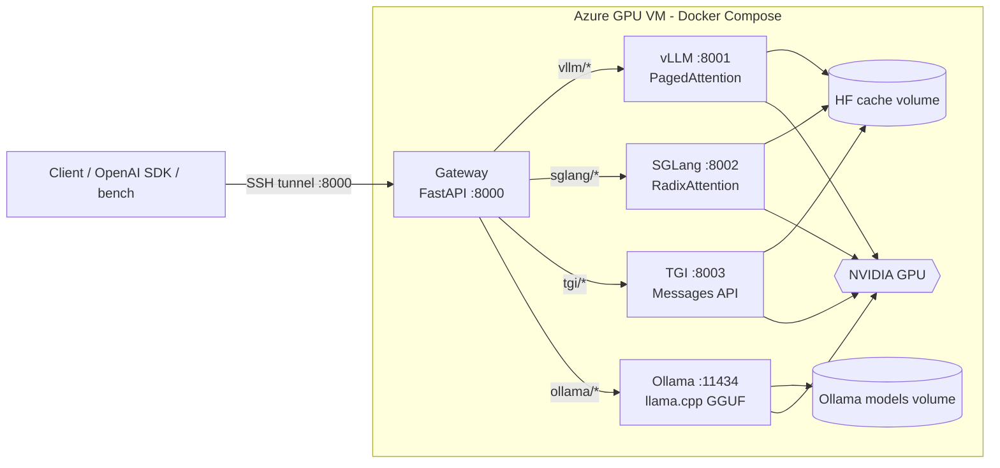

# llm-serving-lab

Unified **OpenAI-compatible gateway** and **benchmark harness** for four popular LLM serving
engines, **vLLM**, **SGLang**, **TGI** and **Ollama**, running with Docker Compose on an
Azure GPU VM (T4 or A100).

* One endpoint (`/v1/chat/completions`, `/v1/completions`, `/v1/models`) routes to any engine
  by model name: `vllm/qwen2.5-1.5b`, `sglang/qwen2.5-1.5b`, `tgi/...`, `ollama/...` or
  `auto/qwen2.5-1.5b`.
* A fair benchmark runs each engine alone on the GPU, sweeps concurrency, measures TTFT, TPOT,
  ITL, E2E latency, tokens/s and error rate, and writes a markdown report with charts.
* The infrastructure is in code: Bicep VM with an SSH-only NSG, cloud-init GPU bootstrap and auto-shutdown.

## Architecture



| Engine | Image (default, override in `compose/.env`) | Compose profile | Host port | Model served |
|---|---|---|---|---|
| vLLM | `vllm/vllm-openai:latest` | `vllm` | 8001 | `Qwen/Qwen2.5-1.5B-Instruct` FP16 |
| SGLang | `lmsysorg/sglang:latest` | `sglang` | 8002 | same |
| TGI | `ghcr.io/huggingface/text-generation-inference:3.3.5` | `tgi` | 8003 | same |
| Ollama | `ollama/ollama:latest` | `ollama` | 11434 | `qwen2.5:1.5b` (GGUF, quantized ⚠️) |

All ports bind to `127.0.0.1` on the VM, and the NSG only allows SSH, so you reach them through
`scripts/tunnel.sh` or `scripts/tunnel.ps1`.

## Quickstart

```bash
# 1. local machine: provision the VM (needs az login + GPU quota)
./infra/deploy.sh quota
./infra/deploy.sh up                       # prints ssh + tunnel commands

# 2. on the VM (after cloud-init finished and rebooted)
cd ~/llm-serving-lab
make env venv                              # compose/.env + Python venv
make up-vllm                               # gateway + vLLM
make smoke                                 # health, models, chat + streaming

# 3. compare all engines (each runs alone on the GPU)
make bench-all                             # -> results/<ts>/report/report.md

# 4. done for the day
./infra/deploy.sh stop                     # or: ./infra/deploy.sh down
```

See the [runbook](docs/runbook.md) for details, troubleshooting and cost notes.

Use it from any OpenAI client through the tunnel:

```python
from openai import OpenAI

client = OpenAI(base_url="http://localhost:8000/v1", api_key="unused")
r = client.chat.completions.create(
    model="sglang/qwen2.5-1.5b",
    messages=[{"role": "user", "content": "Explain RadixAttention in one sentence."}],
)
print(r.choices[0].message.content)
```

## Repository layout

| Path | Contents |
|---|---|
| `gateway/` | FastAPI gateway (`llm_gateway/`), `config.yaml` routing table, Dockerfile, pytest suite (respx-mocked backends) |
| `bench/` | Async load generator (`python -m bench run`) and report builder (`python -m bench report`) |
| `compose/` | `docker-compose.yml` with per-engine profiles, `.env.example`, `all.env` (shared-GPU memory caps) |
| `infra/` | `main.bicep`, `cloud-init.yaml`, `deploy.sh` |
| `scripts/` | `bootstrap_vm.sh`, `run_benchmark.sh`, `smoke_test.sh`, `tunnel.sh` / `tunnel.ps1` |
| `docs/` | [concepts](docs/concepts.md) (engine internals and metrics), [runbook](docs/runbook.md), [results template](docs/results/TEMPLATE.md) |

## Gateway

* **Routing**: `<backend>/<alias>` pins a backend. `auto/<alias>` or a bare alias picks the first
  healthy backend in `routing.fallback_order`. Upstream model ids also resolve.
* **Model mapping**: `gateway/config.yaml` maps aliases to each engine's upstream id, with
  `${VAR:-default}` expansion from `compose/.env`.
* **Streaming**: SSE is relayed byte for byte. Non-streaming responses get `model` rewritten to
  the public name.
* **Resilience**: background health checks (`GET /health`, `?refresh=true` for a live probe),
  connect/read timeouts, and optional fallback (`GATEWAY_FALLBACK_ON_ERROR=true`) on connection
  errors, timeouts and 5xx responses.
* **Observability**: JSON logs per request with `request_id`, backend, status, TTFB and latency;
  `x-request-id`, `x-gateway-backend` and `x-gateway-fallback-from` response headers.

## Development (no GPU needed)

```bash
python -m venv .venv && . .venv/bin/activate     # Windows: .venv\Scripts\activate
pip install -r requirements-dev.txt
ruff check . && ruff format --check .
pytest -q
```

CI (`.github/workflows/ci.yml`) runs ruff and pytest, validates the compose file, builds and
smoke-tests the gateway image, compiles the Bicep template and shellchecks the scripts.

## Notes and caveats

* **T4**: no bf16, so everything runs in `float16`. SGLang uses the Triton attention backend by
  default for sm75 compatibility.
* **Ollama** serves a quantized GGUF model, so its results are not apples-to-apples with the
  FP16 engines. Reports flag this.
* **Image tags**: `latest` tags move. `run_benchmark.sh` records image digests in every report, so pin
  tags in `compose/.env` once you have a working combination.
* **TGI** is in maintenance mode upstream. It is kept as a reference point.

## License

MIT, see [LICENSE](LICENSE).
